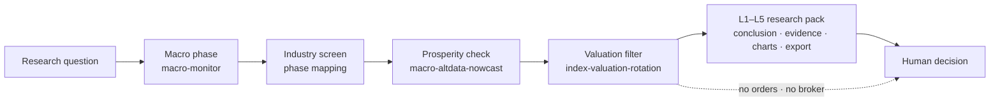

<h1 align="center">Macro-Driven Rotation Agent</h1>

<p align="center"><a href="README.md">简体中文</a> | <b>English</b></p>

<p align="center">Improved Merrill Lynch Clock phase detection + alternative-data nowcast + valuation filter for reviewable industry-rotation research materials.</p>

<p align="center">
  
  
  
  
  
</p>

> This is the QuantSkills community project `agent-macro-driven-rotation`. It helps researchers and AI-agent workflows turn macro phase detection, alternative high-frequency prosperity, and valuation percentiles into **L1–L5 research outputs**. It places no orders, issues no unconditional buy/sell instructions, and makes no return promises. Until maintainer review, it does not claim official QuantSkills endorsement.

## What It Helps You Answer

> **Under the current macro regime, which A-share industries deserve further research?**

## Workflow



## When To Use It

- You want an Improved Merrill Lynch Clock phase read plus industry research screening.
- You need official macro, alternative prosperity, and valuation percentiles in one reviewable report.
- You only need a deep dive on phase, prosperity, or valuation.
- You want the same Agent rules loaded in Claude Code / Codex / Cursor / Hermes / OpenClaw.

## Deliverables

Local runs write to `reports/runtime_out/` by default:

| Level | Content | Form |
| --- | --- | --- |
| L1 | One-sentence conclusion + logic chain | Text / Markdown |
| L2 | Evidence table (value / period / source) | Markdown |
| L3 | Clock, growth-inflation path, valuation-prosperity | PNG or ASCII fallback |
| L4 | Interactive quadrant page | `l4.html` |
| L5 | Macro / prosperity / valuation / recommend tables | `export/*` |

Structure sample: [`reports/samples/e2e_rotation_sample.md`](reports/samples/e2e_rotation_sample.md).

## Directory Layout

```text
agent-macro-driven-rotation/
├── AGENTS.md                 Agent declaration and multi-runtime entry (required)
├── SKILL.md                  Full behavior and usage rules
├── README.md / README.en.md  Repository homepage
├── LICENSE                   GPL-3.0-only
├── agents/                   Cursor / OpenAI / portable loader / publish manifest
├── runtime/                  Unified CLI and orchestration
├── scripts/                  Fetch, code resolve, charts, validate, backtest
├── references/               Methodology guide and Alpha boundary
├── templates/                L4 template
├── reports/samples/          Structure samples
└── requirements.txt
```

## Quick Start

**Option 1: read the sample** — open `reports/samples/e2e_rotation_sample.md`.

**Option 2: trigger inside an AI agent**

```text
Run a full Improved Merrill Lynch Clock industry-rotation research report;
use Pandadata, degrade on any data gap and label what is missing — do not invent numbers.
```

**Option 3: local CLI**

```powershell
py -3.10 -m pip install -r requirements.txt
# set PANDA_DATA_USERNAME / PANDA_DATA_PASSWORD in the environment (never commit secrets)

python -m runtime --self-test
python -m runtime --live --query "which industries deserve attention now"
python -m runtime validate
python -m runtime clean
```

Dependency skills: `macro-monitor`, `macro-altdata-nowcast`, `index-valuation-rotation`.

## Runtime Compatibility

[`AGENTS.md`](AGENTS.md) is the QuantSkills Agent declaration; detailed behavior is in [`SKILL.md`](SKILL.md). Loadable in **Claude Code, Codex, Cursor, Hermes, and OpenClaw**:

| Runtime | Entry |
| --- | --- |
| Claude Code / Codex | Load this folder + three dependency skills |
| Cursor | `.cursor/skills/agent-macro-driven-rotation` + `agents/cursor-rule.mdc` |
| Hermes / OpenClaw | `agents/portable-loader.md` |
| OpenAI-compatible | `agents/openai.yaml` |

Publish metadata: [`agents/skill-manifest.yaml`](agents/skill-manifest.yaml).

## Data Sources And Assumptions

- Data from Pandadata (`panda_data` / `panda-data`).
- Macro phase uses official CPI / GDP / PMI / social-financing series (often lagged 1–2 months).
- Prosperity confirmation uses alternative high-frequency nowcast (timely, non-official).
- Valuation filter uses industry-index PE/PB percentiles and momentum.
- Phase rules and industry mapping: `SKILL.md` and `references/macro-driven-rotation-guide.md`.

## Limitations And Risk Boundaries

- Research and education only; validates no return claims and is not investment advice.
- Data gaps must be labeled degraded / insufficient — never filled with assumptions.
- No unconditional order language (buy / sell / guaranteed / raise position to xx%).
- No broker connectivity, no order execution, no final trading decision on the user's behalf.
- Not an `alpha-*` production factor package; trading-link delivery needs a separate Alpha production process.
- This is a Community Project; listing, recommendation, or official recognition still requires maintainer review.

## References

- [`AGENTS.md`](AGENTS.md) — declaration, scenarios, limits, and metadata
- [`SKILL.md`](SKILL.md) — behavior entry and six-step workflow
- [`references/macro-driven-rotation-guide.md`](references/macro-driven-rotation-guide.md) — methodology detail
- [`references/Alpha因子开发与生产规则V2.md`](references/Alpha因子开发与生产规则V2.md) — Alpha boundary

## Maintainer

Created or maintained by `frocir`.

## License

GNU General Public License v3.0 only (`GPL-3.0-only`). See [LICENSE](LICENSE).

## 🐼 PandaAI / QUANTSKILLS Community

<div align="center">
  
  <br>
  <sub>Scan the QR code to join the PandaAI community for QUANTSKILLS skills, agent workflows, and quantitative research practice.</sub>
</div>
