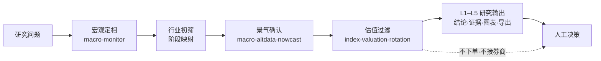

<h1 align="center">宏观驱动行业轮动 Agent</h1>

<p align="center"><b>简体中文</b> | <a href="README.en.md">English</a></p>

<p align="center">改进版美林时钟定相 + 另类景气 Nowcast + 估值过滤，输出可复盘的行业轮动研究材料。</p>

<p align="center">
  
  
  
  
  
</p>

> 这是 QuantSkills 社区项目 `agent-macro-driven-rotation`：面向研究员与 AI Agent 编排场景，把宏观定相、另类高频景气与估值分位整理成 **L1–L5 研究输出**。不自动下单，不输出无条件买卖指令，也不承诺收益。未经维护者审核前，不代表 QuantSkills 官方背书。

## 它帮你回答什么

> **当前宏观阶段下，哪些 A 股行业值得继续研究？**

## 工作流



## 你什么时候会用它

- 需要按改进版美林时钟做一轮宏观定相与行业研究筛选。
- 要把官方宏观、另类景气、估值分位串成一份可复盘报告。
- 只要宏观阶段、景气或估值中的某一段深度分析。
- 希望在 Claude Code / Codex / Cursor / Hermes / OpenClaw 中加载同一套 Agent 规则。

## 产出一览

本地运行产物默认写入 `reports/runtime_out/`：

| 层级 | 内容 | 形式 |
| --- | --- | --- |
| L1 | 一句话结论 + 逻辑链 | 文本 / Markdown |
| L2 | 证据表（数值 / 数据期 / 来源） | Markdown |
| L3 | 钟面、增长-通胀轨迹、估值-景气 | PNG 或 ASCII 降级 |
| L4 | 动态四象限交互页 | `l4.html` |
| L5 | 宏观 / 景气 / 估值 / 推荐表 | `export/*` |

结构样例见 [`reports/samples/e2e_rotation_sample.md`](reports/samples/e2e_rotation_sample.md)。

## 目录结构

```text
agent-macro-driven-rotation/
├── AGENTS.md                 Agent 声明 + 行为入口（QuantSkills 必填）
├── README.md / README.en.md  仓库主页
├── LICENSE                   GPL-3.0-only
├── agents/                   Cursor / OpenAI / portable loader / 发布清单
├── runtime/                  统一 CLI 与编排
├── scripts/                  取数、定码、图表、校验、回测
├── references/               方法指南与 Alpha 边界
├── templates/                L4 模板
├── reports/samples/          结构样例
└── requirements.txt
```

## 快速开始

**方式一：读样例** —— 打开 `reports/samples/e2e_rotation_sample.md`。

**方式二：在 AI Agent 里触发**

```text
按改进版美林时钟做一轮完整行业轮动研究报告；
数据源 Pandadata，遇到数据缺口就降级并标明缺什么，不要编造数值。
```

**方式三：本机 CLI**

```powershell
py -3.10 -m pip install -r requirements.txt
# 在环境变量中设置 PANDA_DATA_USERNAME / PANDA_DATA_PASSWORD（勿提交密钥）

python -m runtime --self-test
python -m runtime --live --query "现在该关注什么行业"
python -m runtime validate
python -m runtime clean
```

依赖 Skill：`macro-monitor`、`macro-altdata-nowcast`、`index-valuation-rotation`。

## 运行时兼容

本仓库以 [`AGENTS.md`](AGENTS.md) 为唯一 Agent 声明与行为入口，可在 **Claude Code、Codex、Cursor、Hermes、OpenClaw** 等运行时中加载：

| 运行时 | 入口 |
| --- | --- |
| Claude Code / Codex | 加载本目录 `AGENTS.md` + 三依赖 Skill |
| Cursor | `.cursor/skills/agent-macro-driven-rotation` + `agents/cursor-rule.mdc` |
| Hermes / OpenClaw | `agents/portable-loader.md` |
| OpenAI 兼容 | `agents/openai.yaml` |

发布元数据：[`agents/skill-manifest.yaml`](agents/skill-manifest.yaml)。

## 数据来源与假设

- 数据来自 Pandadata（`panda_data` / `panda-data`）。
- 宏观定相使用官方 CPI / GDP / PMI / 社融等序列（常见滞后 1–2 月）。
- 景气确认使用另类高频 Nowcast（及时样本，非官方统计）。
- 估值过滤使用行业指数 PE/PB 分位与动量。
- 阶段规则与行业映射见 `AGENTS.md` 与 `references/macro-driven-rotation-guide.md`。

## 限制与风险边界

- 仅供研究与教育参考；不验证任何收益声明，不构成投资建议。
- 数据缺口必须标注为降级 / 证据不足，禁止用假设填补。
- 禁止确定性下单指令（买入 / 卖出 / 必涨 / 仓位提到 xx%）。
- 不接券商接口、不执行订单、不替用户做最终交易决定。
- 不是 `alpha-*` 生产因子包；进入交易链路须另按 Alpha 生产规则交付。
- 本仓库为 Community Project；收录、推荐或官方认可仍需维护者审核。

## 参考文档

- [`AGENTS.md`](AGENTS.md) — 项目声明、行为入口、场景、限制与元数据
- [`references/macro-driven-rotation-guide.md`](references/macro-driven-rotation-guide.md) — 方法细节
- [`references/Alpha因子开发与生产规则V2.md`](references/Alpha因子开发与生产规则V2.md) — Alpha 边界

## 维护者

Created or maintained by `frocir`.

## License

GNU General Public License v3.0 only（`GPL-3.0-only`）。详见 [LICENSE](LICENSE)。

## 🐼 PandaAI / QUANTSKILLS 社群

<div align="center">
  
  <br>
  <sub>扫码加入 PandaAI 社群，交流 QUANTSKILLS 技能、Agent 工作流与量化研究实践。</sub>
</div>


Pandadata 兼容维护：[abgyjaguo](https://github.com/abgyjaguo)，保留原项目作者署名。
